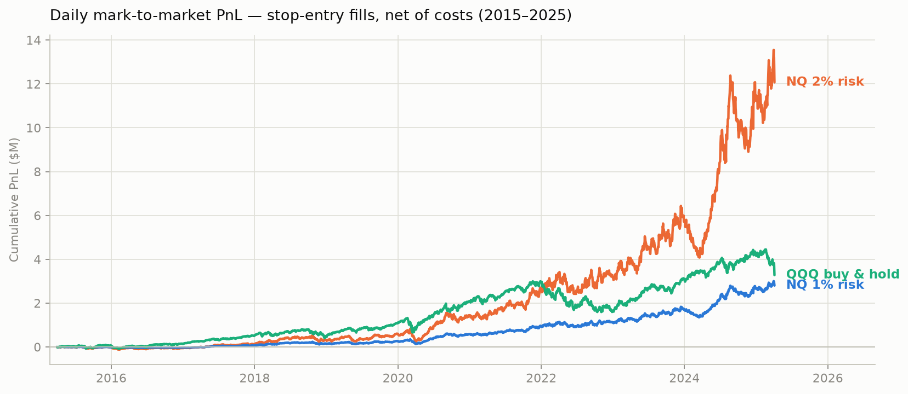
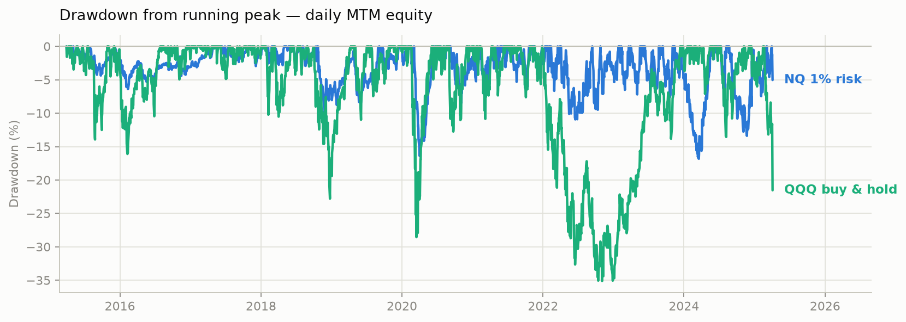

<div align="center">

# 📈 NQ Intraday Breakout
### Systematic Opening-Range Breakout on Nasdaq-100 Futures

*Fade nothing, chase the range break: first 90 minutes of the cash session set the levels · stop orders ride the break · asymmetric holding — longs run up to 5 sessions, shorts die at the close*


-success)




</div>

---

## 📌 TL;DR

A breakout above (below) the range set in the **first 90 minutes of the CME cash session** goes long (short) NQ with a fixed \$2,000 stop / \$4,000 target per contract. Longs are given up to 5 sessions to develop; shorts are always flat by the session close. The rules were **written in MultiCharts in early 2022 and frozen since** — everything after 31 Jan 2022 is out-of-sample *conditional on that provenance claim*.

This repository is the 2025 Python port, rebuilt around a deliberately hostile simulator: daily mark-to-market equity, bar-by-bar overnight stop monitoring on the full ~23h Globex feed, gap-aware fills, and all-in costs. After every correction, the edge still clears **3.2 standard deviations** on 1,725 trades.

## 📊 Results

Backtest on 10 years of real data (Mar 2015 – Apr 2025 · 3.4M one-minute bars → 693k five-minute bars), generated by [`backtest.py`](backtest.py) via [`NQ_breakout.ipynb`](NQ_breakout.ipynb):

| Config | Net PnL | Trades | Avg contracts | PnL/contract | t-stat |
|---|---:|---:|---:|---:|---:|
| 🟢 1% risk · stop entry | \$2,800,810 | 1,725 | 8.9 | \$176.94 | **3.24** |
| 🔴 2% risk · stop entry | \$12,069,455 | 1,725 | 39.7 | \$176.94 | **3.24** |
| ⚪ 1% risk · close entry *(legacy fill)* | \$3,323,800 | 1,736 | 8.9 | \$190.05 | **3.49** |

|  | Sharpe | Volatility | Max DD | Max DD % | CAGR |
|---|:---:|:---:|:---:|:---:|:---:|
| 🟢 NQ 1% risk | **1.02** | 14.1% | −\$508k | −16.8% | 14.3% |
| 🔴 NQ 2% risk | **1.02** | 29.4% | −\$3.48M | −32.1% | 29.3% |
| 🔵 QQQ buy & hold | 0.77 | 22.1% | −\$1.40M | −35.1% | 15.6% |

> 💪 Splitting on **31 Jan 2022** (the rule-freeze date): Sharpe **1.03 → 1.10** pre/post for the 1% regime, **1.00 → 1.13** for 2% — while QQQ buy & hold collapsed from 0.97 to **0.35** over the same out-of-sample window. The edge did not decay after the rules stopped being touched; the benchmark did.

| Segment (1% risk, stop entry) | Sharpe | Volatility | Max DD % | CAGR |
|---|:---:|:---:|:---:|:---:|
| Pre-freeze · 2015-03 → 2022-01 | 1.03 | 10.3% | −16.4% | 10.6% |
| **Post-freeze (OOS)** · 2022-01 → 2025-04 | **1.10** | 20.0% | −16.8% | **22.1%** |
| QQQ same OOS window | 0.35 | 23.9% | −29.6% | 5.6% |

<div align="center">

</div>

Exit mix (1% stop entry): 640 stops · 614 short EOD closes · 321 targets · 150 max-hold expiries. The t-stat tests the mean per-contract PnL against zero, **net of realistic costs**.

## 🔬 The Audit Journey — Optimism That Didn't Survive

The original 2022 notebook reported Sharpe 0.95. That number was rebuilt from scratch through a hostile quant review: every simulation shortcut was found, named, and eliminated. **The headline barely moved — but now it's earned.** The corrections pushed in opposite directions and nearly cancelled:

| # | Legacy shortcut | Verdict | What the fix did |
|---|---|---|---|
| 1 | 📉 Equity updated only at trade exits | ❌ Eliminated | Daily mark-to-market: measured vol 11.3% → 14.1%, max DD 15.1% → 16.8% — open-position swings no longer hidden |
| 2 | 🌙 Stops filled *at the stop level* even through overnight gaps | ❌ Eliminated | Feed turned out to be ~23h Globex: stops now monitored **bar-by-bar through the night**, exits at the exact crossing |
| 3 | 💸 Slippage half of what the docs claimed; broker-only commissions | ❌ Eliminated | 1.5 ticks **per side** ×2 + \$2.50/side all-in — \$20 per round turn per contract |
| 4 | 📅 Weekend padding diluting annualized Sharpe | ❌ Eliminated | Trading-day series only — QQQ's own Sharpe moved 0.64 → 0.77 without QQQ changing at all |
| 5 | 🕰️ "Pre-market 08:30–10:00 **ET**" session label | ❌ Wrong | Timestamps are **Central Time** (proved by cash-open volume spike + the 16:00–17:00 CT maintenance halt): it's an **opening-range breakout**, 09:30–11:00 ET |
| 6 | 🐛 Day-count corruption, window/session overlaps, phantom last-bar trades | ❌ Eliminated | Trading-day mapping per CME convention + 21 unit tests on hand-built bars |
| 7 | 🏆 **The edge itself** | ✅ **Survived** | t = 3.24 on 1,725 trades after every correction above |

## ⚙️ Strategy Rules

```
WINDOW   08:30–10:00 CT (= 09:30–11:00 ET, first 90' of the cash session)
ENTRY    stop order at window high (long) / window low (short) · 10:00–14:30 CT
         max 2 trades/day · never on the session's last bar
STOP     $2,000/contract (100 pts)      TARGET   $4,000/contract (200 pts)
HOLD     longs up to 5 sessions · shorts always flat by session close
SIZE     min( risk% × equity / $2,000 ,  margin cap after 15% buffer )
COSTS    $2.50/side all-in commission + 1.5 ticks/side slippage  →  $20/RT
```

## 🧪 Simulation Engine ([`backtest.py`](backtest.py))

The simulator is built to be pessimistic wherever OHLC data is ambiguous:

- **Bar-by-bar overnight monitoring** — the feed is near-continuous Globex (~1,100 bars/day); a multi-day long has every overnight bar checked against its stop/target, exiting at the exact crossing instead of the next session's opening gap. Trading days follow CME convention (bars after the daily halt belong to the next session).
- **Gap-aware fills** — any bar opening beyond a level fills at the open, not at the level. Stop and target touched in the same bar → stop first (conservative). Exits start from the bar *after* entry (intra-bar sequencing is unknowable).
- **Parametric entry fill** (`entry_mode`) — `'stop'` (default): fill at the breakout level or the gap open; `'close'`: legacy fill at the breakout bar's close. Both are reported because the original MultiCharts convention is not yet recovered.
- **Daily MTM equity** drives both the metrics (√252 annualization on real trading days) and position sizing.
- **Data diagnostics first** ([`run_data_diagnostics`](backtest.py)) — timezone via the cash-open volume signature and the maintenance-halt fingerprint, roll-splice detection via quarterly gap clustering, overnight gap-through-stop exposure. Run it before believing any number.

## 🛡️ Honest Uncertainty

- 🔶 **Entry convention is the biggest open question**: legacy `close` fills consistently beat `stop` fills (Sharpe 1.11 vs 1.02 overall; 1.49 vs 1.10 OOS). Until the original MultiCharts code is recovered, treat that as a real ~10–30% band on every Sharpe above.
- 🔶 **Provenance is claimed, not proven**: this repo's git history starts in 2025; the 2022 rule-freeze rests on the original MultiCharts workspace (recovery = extension #1).
- 🔶 Identical PnL/contract across the 1% and 2% regimes is a **mechanical identity of the simulator** (same fills, only size scales) — it says nothing about real liquidity at ~40 contracts.
- 🔶 Fixed dollar stops are non-stationary: \$2,000 was 2.3% of the index in 2015, 0.5% in 2025.
- 🔶 Static present-day margin applied to all history; slippage independent of order size — stress at 2–4 ticks before trusting the 2% regime.

## 🚀 Quickstart

```bash
git clone https://github.com/giovannibrusco/nq-intraday-breakout.git
cd nq-intraday-breakout
pip install -r requirements.txt

pytest test_backtest.py        # engine sanity check — no data needed (21 tests)
jupyter lab                    # then run NQ_breakout.ipynb top to bottom
```

Read the data-diagnostics cell output first: if the timezone or roll checks warn, fix the data before trusting any metric.

## 🗂️ Repository Structure

```
├── 🐍 backtest.py          Engine — fills, sizing, costs, MTM, metrics, diagnostics, plotting
├── 🧪 test_backtest.py     21 unit tests on hand-built synthetic bars (fills verified to the cent)
├── 📓 NQ_breakout.ipynb    Load → diagnose → run 1%/2% × stop/close → report (real outputs embedded)
├── 📄 requirements.txt     pandas · numpy · matplotlib · pytest
└── 💾 Data/  (local only)  nq-10y-1min.csv + QQQ_daily.csv — not committed
```

## 💾 Data

Raw market data is **not** included:

- **NQ futures** — continuous front-month, 1-minute bars, Mar 2015 – Apr 2025, near-full Globex session, Central Time, back-adjusted (verified by the roll diagnostic) → `Data/nq-10y-1min.csv`
- **QQQ daily** — benchmark closes → `Data/QQQ_daily.csv`

`load_nq_1min` reads `.csv` and `.csv.gz` transparently and resamples to 5-minute bars on the fly.

## 🎓 Provenance

The trading rules were designed in **early 2022** on MultiCharts and have not been modified since; this repository is a faithful-in-spirit Python re-implementation whose fill conventions are stricter than (and not yet diffed against) the original. The post-2022 segment is therefore out-of-sample **conditional on that claim** — recovering the original `.pla`/EasyLanguage source, with its file dates, is the single highest-value pending task: it would both validate the port trade-by-trade and turn the OOS claim from asserted into documented.

## ⚠️ Disclaimer

This project is for **educational and research purposes only**. It is not financial advice. Past performance does not guarantee future results. Futures trading involves substantial risk of loss and leverage amplifies both gains and losses. The model assumes continuous market access and ignores exchange halts; verify all data against proprietary feeds before deploying capital.
